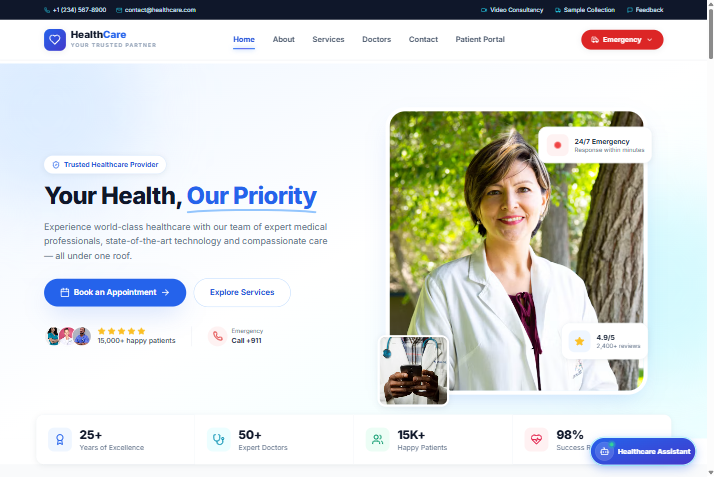
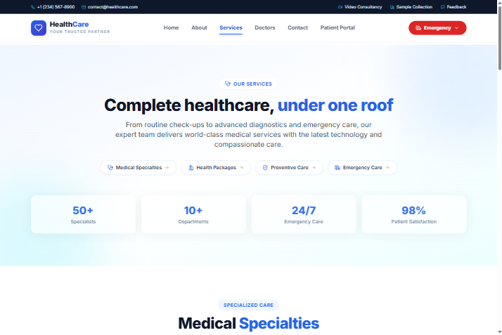

<div align="center">

# 🏥 HealthCare — Modern Healthcare Platform

A full-featured, responsive healthcare website where patients can explore services, book appointments, consult doctors online, and manage their medical records — all from one modern web application.

**🌐 Live:** [https://react-healthcare.vercel.app/](https://react-healthcare.vercel.app/)


</div>

---

## 📖 Overview

**HealthCare** is a complete healthcare web application built for clinics and hospitals to offer a seamless digital experience to their patients. It covers the entire patient journey — from discovering services and doctors, to booking appointments, video consultations, home sample collection, and accessing reports through a secure patient portal.

The project also includes an **admin panel** for staff to manage patients, appointments, medical records and payments, plus an **AI-powered chatbot** that answers common patient questions 24/7.

The UI is fully responsive, animation-rich, and built with a clean, professional design system so it feels like a real product — not a template.

---

## 📸 Screenshot

<p align="center">
  
  
</p>

---

## 🛠️ Tech Stack

| Layer | Technology |
|---|---|
| **Language** | TypeScript 5.5 |
| **UI Library** | React 18 (Function components + Hooks) |
| **Build Tool** | Vite 5 |
| **Routing** | React Router DOM v6 |
| **Styling** | Tailwind CSS 3.4 + PostCSS + Autoprefixer |
| **Animation** | Framer Motion 12, GSAP 3.12 |
| **Icons** | Lucide React |
| **PDF Generation** | jsPDF |
| **Linting** | ESLint 9 (flat config) |
| **Deployment** | Vercel |

### 💡 Why these technologies?

- **React 18** — the industry standard for SPAs; huge ecosystem, great developer experience, and component reuse keeps the codebase maintainable.
- **TypeScript** — catches bugs at compile time instead of runtime; essential for a project of this size with many pages and data models.
- **Vite** — near-instant dev server startup and optimized production builds, much faster than older bundlers like Webpack.
- **Tailwind CSS** — utility-first styling lets us build a consistent design system quickly without maintaining a separate CSS file for every component.
- **Framer Motion** — declarative, performant animations (page transitions, hover states, loading effects) with minimal code.
- **React Router v6** — nested routing, route params (`/doctors/:id`), and lazy-loading support out of the box.
- **Lucide React** — clean, consistent open-source icon set that pairs perfectly with Tailwind.

---

## ✨ Key Features

### 👤 Public Website
- **Homepage** — hero section, stats, services preview, why-choose-us, how-it-works, doctors, health packages, FAQ, testimonials, CTA
- **Services & Service Details** — full catalog with individual detail pages
- **Doctors & Doctor Profiles** — browse specialists, view profiles, book appointments
- **About, Contact, FAQ, Feedback** pages
- **Emergency page** with 24/7 helpline details
- **Video Consultation** & **Home Sample Collection** booking flows
- **Legal pages** — Privacy Policy & Terms of Service
- **AI Chatbot** — answers patient questions instantly
- **Custom 404 page** with smart suggestions to relevant sections
- **Eye-catching loader** — branded ECG heartbeat animation on boot and route transitions
- **Scroll-to-top button** with live circular progress indicator

### 🔐 Patient Portal (`/portal`)
- Dashboard with health stats
- Appointment history & management
- Medical records & reports
- Payment history
- Profile settings

### 🛡️ Admin Panel
- **Admin-only login** at `/admin/login` (kept out of the public navbar)
- Patient management (view, add, edit)
- Appointment oversight
- Medical records management
- Payments tracking
- Admin statistics dashboard

### ⚙️ Platform Highlights
- Fully responsive (mobile → desktop)
- Route-based code splitting (lazy loading) for fast initial load
- Smooth page transitions and micro-interactions
- Cart & checkout flow with PDF invoice generation (jsPDF)

---

## 📦 Dependencies

### Runtime
| Package | Purpose |
|---|---|
| `react` / `react-dom` ^18.3.1 | Core UI library |
| `react-router-dom` ^6.22.3 | Client-side routing |
| `framer-motion` ^12.4.1 | Animations & transitions |
| `gsap` ^3.12.5 + `@gsap/react` | Advanced scroll/entrance animations |
| `lucide-react` ^0.344.0 | Icon library |
| `jspdf` ^2.5.1 | PDF invoice/report generation |

### Development
| Package | Purpose |
|---|---|
| `vite` ^5.4.2 | Build tool & dev server |
| `typescript` ^5.5.3 | Type safety |
| `tailwindcss` ^3.4.1 / `postcss` / `autoprefixer` | Styling pipeline |
| `eslint` ^9 + `typescript-eslint` | Code linting |
| `@vitejs/plugin-react` | React fast refresh & JSX transform |

---

## 🚀 Getting Started (Local Setup)

### Prerequisites
- **Node.js** ≥ 18 (recommended: LTS)
- **npm** ≥ 9 (or yarn/pnpm)

### Steps

```bash
# 1. Clone the repository
git clone https://github.com/saikatghosh3/react-healthcare.git
cd react-healthcare

# 2. Install dependencies
npm install

# 3. Start the development server
npm run dev
```

The app will be available at **http://localhost:5173** (default Vite port).

### Other Commands

```bash
npm run build     # Production build → dist/
npm run preview   # Preview the production build locally
npm run lint      # Run ESLint checks
```

---

## 🧩 Challenges Faced & How They Were Solved

### 1. **Admin access leaking into the public navbar**
**Challenge:** The "Admin Panel" link was showing in the navigation for authenticated admins, mixing admin UX with the public site.
**Solution:** Removed all admin links from the navbar (desktop + mobile) and made `/admin/login` the single, dedicated admin entry point. Admin logout was moved into the admin dashboard itself.

### 2. **Oversized, "AI-generated" looking headings**
**Challenge:** Hero `h1` tags used `text-6xl` / `3.4rem` sizes that looked exaggerated and generic.
**Solution:** Re-scaled every hero heading across the site to a consistent, natural type scale (`text-3xl → text-5xl`) with tuned line-height and spacing for a more editorial, human feel.

### 3. **No proper scroll-to-top experience**
**Challenge:** A plain scroll button gave no feedback about page progress.
**Solution:** Rebuilt it as a circular button with an SVG **progress ring** that fills as you scroll down, with spring entrance/exit animations and focus-visible accessibility states.

### 4. **Broken URLs gave a blank page**
**Challenge:** Unknown routes rendered nothing, creating a dead-end experience.
**Solution:** Built a custom **404 page** that suggests 8 relevant pages/sections, plus quick actions (Go Back, Book Appointment, Homepage) and support contact options.

### 5. **No loading feedback on slow networks**
**Challenge:** Route changes and first paint had no visual feedback.
**Solution:** Created a branded **ECG heartbeat loader** (pulsing heart + animated heartbeat line) shown as a full-screen boot splash and as the `Suspense` fallback for every lazy-loaded route.

### 6. **Heavy initial bundle**
**Challenge:** Importing 20+ pages eagerly made the first load slow.
**Solution:** Converted every page to `React.lazy()` with a `Suspense` fallback, enabling route-based code splitting — the browser only downloads the code for the page being visited.

### 7. **State shared across many pages**
**Challenge:** Bookings, cart, and auth state needed to be available everywhere without prop-drilling.
**Solution:** Used React Context (`BookingProvider`) combined with `localStorage` for persistence, keeping state accessible from any component.

---

## 🔗 Relevant Links

| Link | URL |
|---|---|
| 🌐 **Live Site** | [https://react-healthcare.vercel.app/](https://react-healthcare.vercel.app/) |
| 📂 **Source Code** | [https://github.com/saikatghosh3/react-healthcare](https://github.com/saikatghosh3/react-healthcare) |
| 🛡️ **Admin Login** | [https://react-healthcare.vercel.app/admin/login](https://react-healthcare.vercel.app/admin/login) |
| 👤 **Patient Portal** | [https://react-healthcare.vercel.app/portal](https://react-healthcare.vercel.app/portal) |
| ❓ **FAQ** | [https://react-healthcare.vercel.app/faq](https://react-healthcare.vercel.app/faq) |

---

## 📁 Project Structure

```
react-healthcare/
├── public/                  # Static assets
├── src/
│   ├── components/          # Reusable UI (Navigation, Footer, Loader, BackToTop, Chatbot, modals)
│   │   ├── layout/          # Site-wide layout components
│   │   ├── Loader/          # Branded ECG loader
│   │   └── Chatbot/         # AI chatbot
│   ├── pages/               # Route-level pages
│   │   ├── Home/            # Homepage + sections
│   │   ├── Admin/           # Admin login & dashboard
│   │   ├── PatientPortal/   # Patient portal
│   │   ├── NotFound/        # Custom 404 page
│   │   └── ...              # About, Services, Doctors, Contact, etc.
│   ├── context/             # React Context providers (Booking)
│   ├── data/                # Static data (chatbot knowledge base)
│   ├── hooks/               # Custom hooks
│   └── utils/               # Helper utilities
├── index.html
├── tailwind.config.js
├── vite.config.ts
└── package.json
```

---

## 📄 License

This project is open source and available for learning and portfolio purposes.

---

<div align="center">

**Made with ❤️ using React, TypeScript & Tailwind CSS**

[🌐 Live Site](https://react-healthcare.vercel.app/) · [📂 GitHub](https://github.com/saikatghosh3/react-healthcare)

</div>
